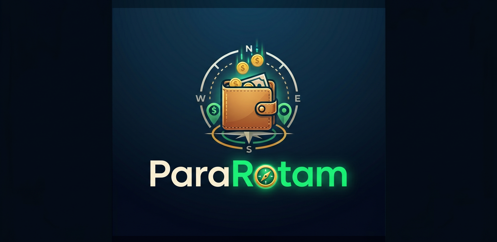
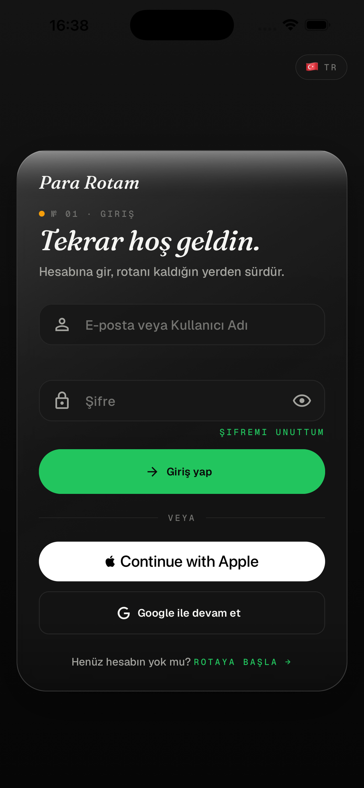
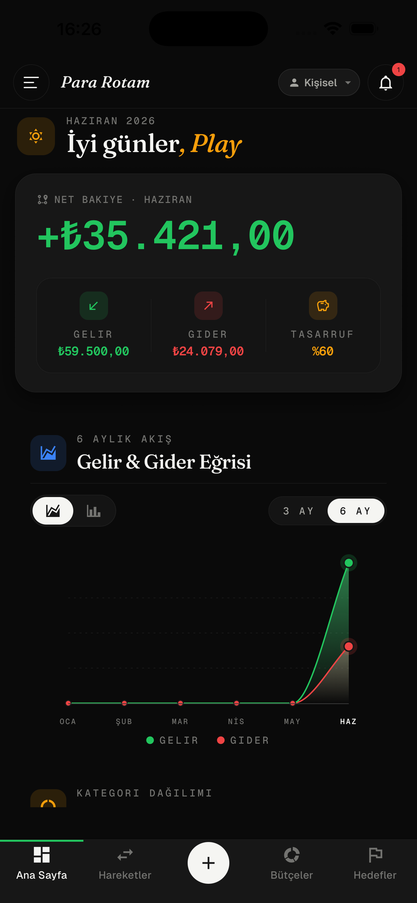
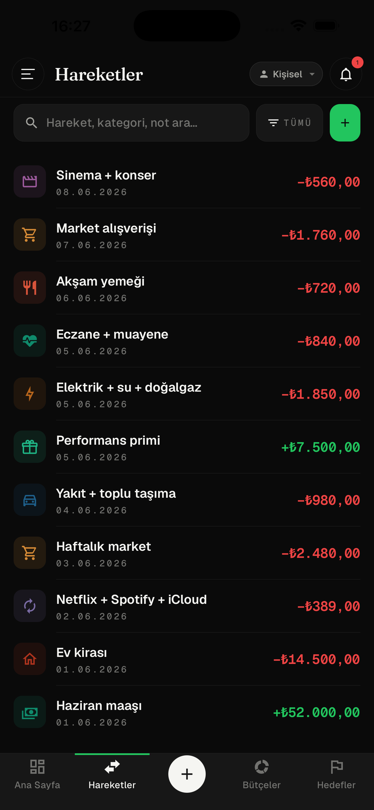
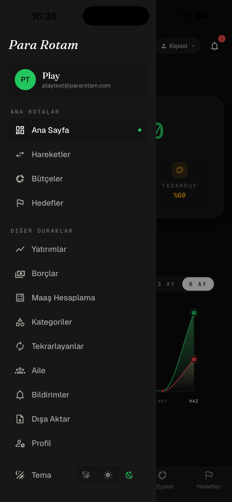
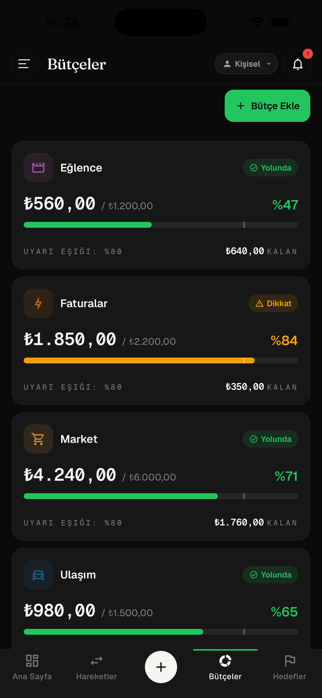
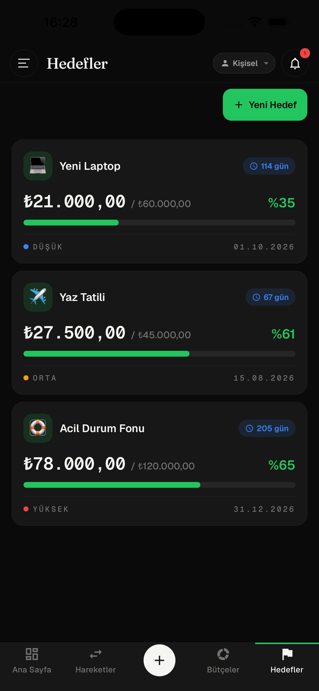
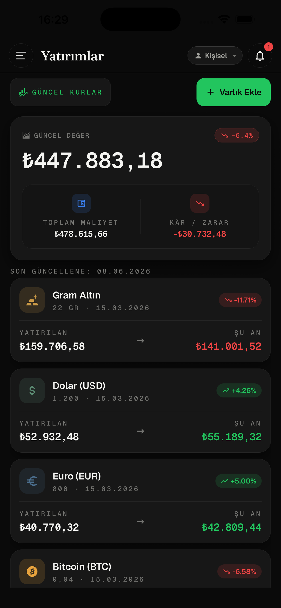
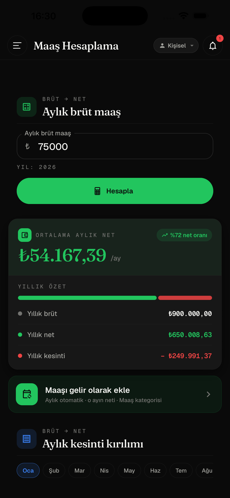

<p align="center">
  
</p>

<p align="center">
  <b>Kişisel ve aile finans yönetimi</b> — gelir/gider, bütçe, hedef, yatırım, borç ve maaş takibi tek uygulamada.<br>
  .NET backend · React web · Expo (iOS/Android) mobil · 5 dil
</p>

<p align="center">
  
  
  
  
  
</p>

> **Not:** ParaRotam bir süre App Store ve Google Play'de yayındaydı. Uygulama artık yayında değil; kaynak kodu öğrenmek, incelemek ve kendi projelerinizde kullanmak için açık kaynak olarak paylaşıldı.

## Ekran görüntüleri

<table>
  <tr>
    <td align="center"><br><sub>Giriş</sub></td>
    <td align="center"><br><sub>Ana sayfa</sub></td>
    <td align="center"><br><sub>Hareketler</sub></td>
    <td align="center"><br><sub>Menü</sub></td>
  </tr>
  <tr>
    <td align="center"><br><sub>Bütçeler</sub></td>
    <td align="center"><br><sub>Hedefler</sub></td>
    <td align="center"><br><sub>Yatırımlar</sub></td>
    <td align="center"><br><sub>Maaş hesaplama</sub></td>
  </tr>
</table>

## Özellikler

- **Gelir & gider takibi** — kategoriler, tekrarlayan işlemler, taksitler, kira
- **Bütçeler ve hedefler** — aylık kategori bütçeleri, birikim hedefleri, ilerleme takibi
- **Yatırımlar** — döviz, altın, kripto, hisse ve TEFAS fonları; canlı fiyat ve **fiyat alarmı**
- **Borçlar** — alacak/verecek, otomatik/manuel ödeme, vade hatırlatmaları
- **Maaş hesaplama** — brütten nete hesap ve maaşın otomatik gelir olarak işlenmesi
- **Aile modu** — ortak hane, davet sistemi, kişisel kaydı aileyle paylaşma
- **Ortak kasa** — grup masrafları ve "kim kime ne kadar borçlu" netleştirmesi
- **Altın günü** — gün/ROSCA takibi
- **Akıllı giriş** — fişten (OCR) ve yazı/sesle yapay zekâ destekli işlem ekleme
- **Raporlar** — aylık PDF özeti, Excel dışa aktarma, abonelik radarı, enflasyon (TÜFE) hesaplayıcı
- **Gerçek zamanlı** — SignalR ile canlı bildirimler ve önbellek güncelleme
- **5 dil** — Türkçe, İngilizce, Arapça (RTL), İspanyolca, Almanca
- **Giriş seçenekleri** — e-posta/şifre, Google, Apple ve şifresiz (magic link)
- **Premium abonelik** — RevenueCat ile iOS/Android uygulama içi abonelik altyapısı

## Mimari

```
ParaRota.Backend/   .NET 10 Web API — Clean Architecture
                    Domain / Application / Persistence / Infrastructure / Presentation / WebApi
ParaRota.Web/       React 19 + Vite + TypeScript + MUI web istemcisi
ParaRota.Mobile/    Expo SDK 54 + React Native 0.81 (iOS & Android)
deploy/             Docker Compose, nginx ve sunucu kurulum script'leri (referans)
docs/               Tasarım ve özellik planları
```

| Katman | Teknoloji |
|---|---|
| Backend | .NET 10, PostgreSQL 16, MediatR, FluentValidation, AutoMapper, ASP.NET Identity, Hangfire |
| Gerçek zamanlı | SignalR |
| Web | React 19, Vite, TypeScript, MUI, TanStack Query, Zustand, react-i18next |
| Mobil | Expo (Router, Updates), React Native, Reanimated, RevenueCat |
| Yapay zekâ / OCR | Claude (Anthropic) birincil, Gemini yedek |
| Raporlama | QuestPDF (PDF), ClosedXML (Excel) |
| Piyasa verisi | TCMB EVDS, TEFAS, CoinGecko, Yahoo Finance |

## Hızlı başlangıç

**Gereksinimler:** .NET 10 SDK, Node.js 20+, Docker (PostgreSQL için)

```bash
# 1) PostgreSQL
cd ParaRota.Backend && docker compose up -d

# 2) Backend  →  http://localhost:5143  (Swagger: /swagger)
dotnet run --project src/External/ParaRota.WebApi

# 3) Web  →  http://localhost:5173
cd ../ParaRota.Web && npm install && npm run dev

# 4) Mobil (Expo)
cd ../ParaRota.Mobile && npm install && npx expo start
```

Backend ilk açılışta veritabanı migration'larını uygular, rolleri ve sistem kategorilerini kendisi oluşturur.

## Yapılandırma

Repoda **hiçbir gizli anahtar yoktur**. Kendi değerlerinizi girmeniz gerekir:

**Backend** — `dotnet user-secrets` (geliştirme) veya ortam değişkenleri (üretim):

| Anahtar | Açıklama |
|---|---|
| `Jwt:SigningKey` | JWT imzalama anahtarı (zorunlu, 64+ karakter) |
| `ConnectionStrings:DefaultConnection` | PostgreSQL bağlantısı (üretim) |
| `Smtp:*` | E-posta gönderimi (doğrulama, şifre sıfırlama) |
| `Anthropic:ApiKey` / `Gemini:ApiKey` | Fiş OCR ve yapay zekâ özellikleri |
| `Evds:ApiKey` | TCMB döviz/enflasyon verisi |
| `GoogleAuth:ClientSecret`, `AppleAuth:*` | Sosyal giriş |
| `RevenueCat:WebhookAuthHeader` | Abonelik webhook doğrulaması |

Örnek: `deploy/.env.example`, ayrıntı: `deploy/SECRETS.md`.

**İstemciler** — `YOUR_*` ile başlayan yer tutucuları değiştirin:
`ParaRota.Mobile/app.json` (Google client ID'leri, EAS proje ID'si, RevenueCat anahtarları, API adresi), `ParaRota.Mobile/eas.json`, `ParaRota.Web/public/appsettings.json`.

## Faydalı komutlar

```bash
# Web
npm run build        # üretim derlemesi
npm run lint
npm run i18n:check   # 5 dilin anahtar eşitliği

# Backend migration
dotnet ef migrations add <Ad> \
  --project src/External/ParaRota.Persistence \
  --startup-project src/External/ParaRota.WebApi
```

Alt projelerin kendi README'leri: [Backend](ParaRota.Backend/README.md) · [Web](ParaRota.Web/README.md) · [Mobil](ParaRota.Mobile/README.md)

## Üçüncü parti lisanslar

- **QuestPDF** — Community lisansı (yıllık geliri 1M$ altındaki kullanım için ücretsiz).
- **ClosedXML** — MIT.

## Lisans

[MIT](LICENSE) © 2026 Taner Topçuoğlu
